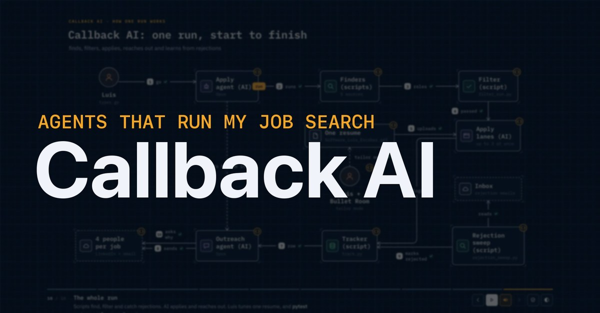
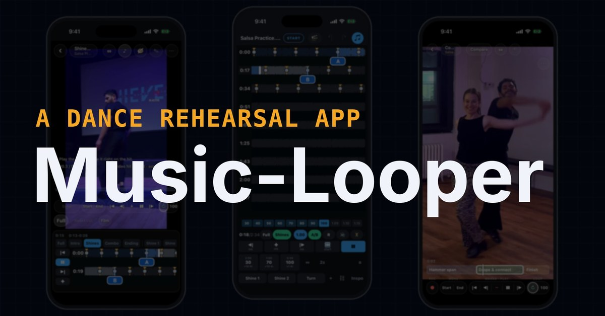

### Hi, I'm Luis Escobar

Software engineer with 2 years shipping features on VMware's CloudHealth platform for 2M+ users.
Now building AI agent workflows on Claude Code, a mobile rehearsal app for dancers, and competing at NYC AI hackathons.

#### Featured projects

<table>
  <tr>
    <td width="50%"></td>
    <td width="50%"></td>
  </tr>
</table>

**[Callback AI](https://github.com/Escobar-Luis/callback-ai-showcase)** 
*Automated job search, application, and outreach with Claude Code*

- Built an internal agent with custom Claude Code skills and Python scripts that finds, filters, and applies to jobs, with pytest and promptfoo regression tests that flag when its output gets worse
- Wired the agent's tools and workflows: Gmail through MCP, my browser sessions through OpenCLI, and apply and outreach running in parallel on separate Chrome profiles, with outreach rules I wrote
- Automated how I learn design: a book-consult skill finds the O'Reilly chapter for my blocker and asks it for the fix, and a voiced chalk-talk diagram shows the architecture my agents built

**[Music-Looper](https://github.com/Escobar-Luis/music-looper-showcase)** 
*A dance rehearsal mobile app for iOS and Android*

- Cut drill setup from several minutes to two taps with saved song sections and automatic speed ramps that speed up each rep, with a pause between reps so dancers never stop the song
- Filed teacher clips and past takes under each song section, so a long press shows every reference for that part, and added looped, slowed video and side-by-side compare to choreograph faster

#### Hackathon builds

- **[Secret Sauce](https://github.com/Escobar-Luis/secret-sauce)**, 1st place out of 10 teams at the NEAR Private AI Hackathon NYC: a private AI analyst for small restaurants. The owner chats with their own books, and the books stay on the owner's Mac. In the demo data it found $480 of cash-drawer shortages, growing every week. Team of 4. [Demo video](https://github.com/Escobar-Luis/secret-sauce/blob/main/docs/media/secret-sauce-demo.mp4) · [Featured on X](https://x.com/buidlcity/status/2122092479289622595)
- **[Day Trader AI](https://github.com/Escobar-Luis/quant-bot)**: would copying a paid day-trading course have made money? AI writes down each trade, code checks and backtests it. One course turned $10,000 into $9,766 while the S&P 500 made $11,964. Solo, Money Talks 2 hackathon. [Live site](https://day-trader-ai.vercel.app)
- **[Billing Rep](https://github.com/wsspang-spec/ai-billing-rep)**: an agent that decides if a telecom bill increase is justified before anyone pays it. With no human approval, the send returns 403. Team of 3, Daytona HackSprint NYC; I built the starter kit and the working app. [Devpost](https://devpost.com/software/billing-rep-ai-telecom-billing-agent)
- **[Stop Complaining](https://github.com/Escobar-Luis/complain-or-get-hired)**: say "rats on my block" and an agent finds the open city job that fixes it, with its real pay. Hybrid search fixed the ranking. Solo in about 3 hours, Mistral x Elastic Hack Night. [Devpost](https://devpost.com/software/stop-complaining)
- **[iMesh](https://devpost.com/software/imesh)**: voice notes and photos across a simulated 5-node mesh with 20% loss per hop. A status only reads "complete" when the far phone acks it. Team of 5, Get Hired Hack at Columbia Startup Lab.

#### Technical skills

| Area | Tools |
| --- | --- |
| Languages | TypeScript, JavaScript, Java, Kotlin, Python, Ruby, SQL |
| Frameworks | React, React Native, Expo, Node.js, Ruby on Rails, GraphQL, REST, Skia, Reanimated |
| Infrastructure | Kafka, Terraform, PostgreSQL, MySQL, Docker, Jenkins, Git, CI/CD, OAuth 2.0, Claude Code |

#### What I'm looking for

AI engineering, forward deployed engineering and entry-level software engineering roles. NYC or remote. The fastest way to reach me is [LinkedIn](https://www.linkedin.com/in/luisalfredoescobar/) or [email](mailto:lae311@stern.nyu.edu).
